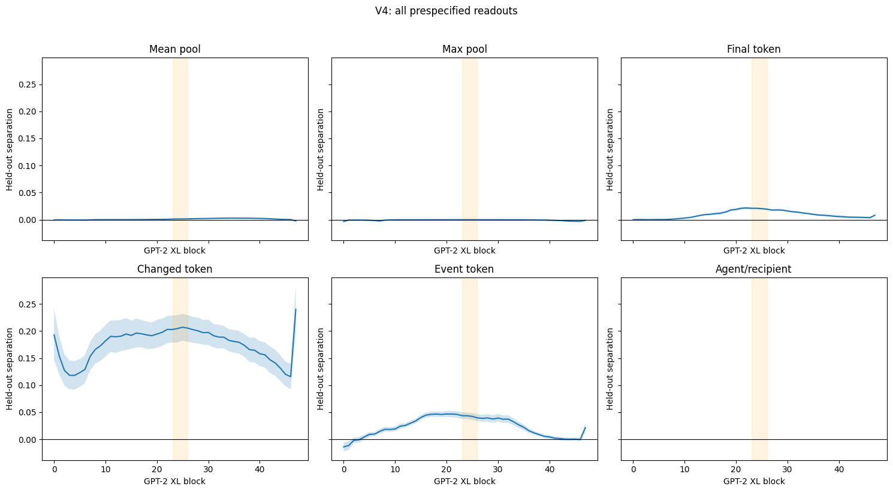

# SituatiONION 🧅

**Layer-wise analysis of situation-sensitive and relational representations in GPT-2 XL.**

SituatiONION investigates how information about events, participant roles, causal roles, and temporal relations is recoverable across transformer depth. It combines controlled paraphrase–counterfactual comparisons, token-specific representation analysis, diagnostic probing, and compositional generalization experiments.

The project began with a hypothesis of a transient middle-layer situation representation. Subsequent experiments support a more differentiated account: measured situation sensitivity and relational accessibility depend on **layer, readout, task, and evaluation split**. Selected relational probes outperform lexical and compressed-representation controls, but the evidence does not establish a single situation-model layer or causal use of the decoded information.

## Research questions

- Where do representations distinguish situation-preserving paraphrases from situation-changing counterfactuals?
- Which situation variables remain decodable beyond strong controls?
- How does relational accessibility vary across token positions and layers?
- How well does this accessibility extend to unfamiliar entities, templates, and composition depths?

Here, *situation-sensitive* refers to an operational measurement on controlled linguistic stimuli. It does not imply that a human-like situation model has been established.

## Development and evidence

| Stage | Contribution | Interpretation carried forward |
|---|---|---|
| **V2 — Exploratory interpretation** | Paraphrase similarity, token trajectories, shared PCA, and attention diagnostics motivated an assembly–stabilization–collapse hypothesis. | Geometric patterns motivate hypotheses; they do not independently establish semantic assembly, role binding, or collapse. |
| **V3 — Controlled diagnostics** | Introduced base–paraphrase–counterfactual triples, a situation-separation score, alternative readouts, and lexical controls. Project notes report weak pooled separation and motivate an earlier-emergence alternative. | Test sensitivity to changed situations explicitly, and compare readouts before assigning a special role to a layer band. The small seed dataset is exploratory. |
| **V4 — Structural controls** | Expanded to a 300-triple design with structural matching and held-out evaluation. Separation differed substantially across readouts. | Layers 23–26 show local enhancement for some readouts within a much broader depth profile. |
| **V5 / V5.7 — Decodability and validation** | Compared layer-wise probes with lexical, random-projection, majority, and shuffled-label controls; evaluated selected advantages with paired bootstrap resampling. | Selected relational configurations retain positive control-adjusted advantages. Perfect raw accuracy alone is insufficient evidence of a distinctive signal. |
| **V6 — Relational dynamics and abstraction** | Saved reports map accessibility across evaluation splits and compare final-token and query-entity-pair readouts across composition depths. | Preliminary figures show split dependence and weaker peak advantages at unseen depths; they do not demonstrate uniform compositional generalization. |

## Methods

### Controlled situation separation

Each triple contains a base sentence, a meaning-preserving paraphrase, and a counterfactual that changes a situation variable. V4 controls lexical and structural differences and evaluates multiple representation readouts.

For layer `l` and readout `r`, the situation score is:

```text
S(l, r) = mean[cos(h(base), h(paraphrase)) − cos(h(base), h(counterfactual))]
```

A positive score indicates greater similarity to the paraphrase than to the counterfactual. Readouts include changed token, event token, final token, ordered agent/recipient representations where applicable, mean pooling, and max pooling.

### Diagnostic probing

V5 evaluates situation variables across layers, readouts, and held-out splits. Its conservative decoding advantage is:

```text
advantage = balanced_accuracy(full hidden-state probe)
            − max(balanced_accuracy(lexical control),
                  balanced_accuracy(random-projection control))
```

The random-projection control uses compressed hidden states; it is not a chance baseline. An advantage measures performance relative to these particular controls, rather than proving an exclusively semantic representation.

### Relational accessibility and abstraction

V6 examines distributions of positive decoding advantage across readouts and generalization beyond familiar configurations. Its migration framework describes changes in accessibility distributions across adjacent layers, not literal or causal information transport. The saved V6.2 report compares composition depths `k = 2–4` (seen) with `k = 5–10` (unseen), using final-token and query-entity-pair readouts.

## Results to date

### V4: situation separation depends on the readout

The [recorded V4 results](figures2/v4Results.md) report:

| Readout | Reliably positive layers | Qualification |
|---|---|---|
| Changed token | 48/48: 0–47 | The directly changed position can carry local distinguishing information from the outset. |
| Final token | 43/48: 1–2 and 7–47 | Broad separation across depth. |
| Event token | 38/48: 4–40 and 47 | Separation develops and weakens with depth. |
| Mean pool | 35/48: 11–45 | Absolute separation is very small. |
| Max pool | 0/48 | No reliably positive separation under this metric. |
| Agent/recipient | Not evaluable in the aggregate | No aggregate conclusion. |

Layers **23–26** exceed neighboring layers for the changed-token readout (`Δ = 0.00702`, reported effect size `0.744`) and final-token readout (`Δ = 0.00181`, effect size `0.578`). This is partial, readout-specific support for the original hypothesis. There is no common emergence layer across readouts.



### V5: relational advantages survive selected control comparisons

The executed [V5 validation notebook](Copy_of_v5_Decodability_MechDiagnostic.ipynb) reports the following selected configurations on the combined held-out split:

| Variable | Configuration | Test examples | Conservative advantage | 95% paired bootstrap interval |
|---|---|---:|---:|---|
| Temporal relation | Layer 38, max pool | 18 | +0.500 | [0.500, 0.500] |
| Cause-holder role | Layer 16, changed token | 36 | +0.333 | [0.187, 0.500] |
| Role assignment | Layer 16, changed token | 18 | +0.250 | [0.083, 0.458] |
| Event state | Layer 24, changed token | 18 | 0.000 | [0.000, 0.000] |
| Polarity | Layer 24, changed token | 18 | 0.000 | [0.000, 0.000] |

All five selected full-representation probes achieved perfect balanced accuracy. The controls also achieved perfect accuracy for event state and polarity, explaining their zero advantage. These are selected configurations, not averages across every layer or split.

The degenerate temporal-relation interval reflects fixed predictions on a small held-out sample under class-stratified resampling; it does not imply zero population uncertainty. The intervals also do not account for selecting configurations after inspecting the atlas.

Readout-switch permutation tests found **no significant enrichment** in layers 20–40 (`p = 0.180`) or the reference region 22–27 (`p = 0.351`). Visual switching patterns therefore do not establish a localized transition region. The saved validation report marks independent CPU/GPU implementation validation as pending.

Max pooling's positive V5 temporal-probe result is compatible with its weak V4 result: supervised decoding and unsupervised cosine separation measure different properties.

### V6: accessibility and generalization remain conditional

The [V6.1 accessibility report](figures2/V6_1_accessibility_heatmaps%20%282%29.pdf) displays layer × readout maps separately for entity, template, and combined holdouts. Temporal-relation accessibility illustrates the split dependence: the combined split shows a prominent positive max-pool region, whereas the template-held-out map shows no positive advantage and the entity-held-out map has much smaller positive values. These splits should not be treated as a simple ordered difficulty scale.

The [V6.2 abstraction report](figures2/V6_2_Relational_Abstraction_Figures%20%282%29.pdf) shows:

- Peak advantages are generally lower at unseen composition depths `k = 5–10` than at seen depths `k = 2–4` in the full-condition summary.
- Positive peak values remain at unseen depths, but are small near `k = 10`; layer-wise performance is not uniformly positive.
- The maximizing layer varies with composition depth and readout, without a monotonic shift toward deeper layers.

These are **descriptive observations from saved figures**, not significance-tested claims of systematic abstraction. The local V6 notebook contains an unresolved merge conflict, and the saved composition-depth report differs from its outlined K0–K6 holdout protocol. The figure results and that planned protocol are therefore kept distinct here. Completed evidence for geometric coupling, a shared Relation Lens, or causal handoff is not established by these reports.

## Scope and limitations

The evidence concerns GPT-2 XL and controlled stimuli. Broader claims require larger independent evaluations and additional models. Decodability and representational separation do not establish causal necessity, behavioral reasoning ability, or a human-like situation model. Likewise, a zero control-adjusted advantage does not imply that the model lacks the corresponding information.

The original assembly–stabilization–collapse account remains a motivating hypothesis. The current empirical emphasis is on **distributed, readout-dependent relational accessibility and its generalization limits**. Causal interventions are the next stage of investigation, outlined in [V7](v7_RealCausal.ipynb).

## Repository guide

| Resource | Contents |
|---|---|
| [V2 notebook](SituatiONION2_Interp.ipynb) | Exploratory geometry and interpretation. |
| [V3 notebook](SituatiONIONv3_ControlledDiag.ipynb) | Controlled situation score and readout diagnostics. |
| [V4 notebook](SituatiONIONv4_structural_controls.ipynb) | Structural controls and held-out separation analysis. |
| [Dataset builder](structural_controls.py) | Matched triples and matching diagnostics; no model inference. |
| [V5 notebook](v5_Decodability_MechDiagnostic.ipynb) | Decodability analysis design and implementation. |
| [Executed V5 copy](Copy_of_v5_Decodability_MechDiagnostic.ipynb) | Saved atlas outputs and V5.7 statistical validation. |
| [V6 notebook](v6TightClean_RelationalDynamics.ipynb) | Relational dynamics framework; currently requires merge resolution. |
| [Figures and reports](figures2/) | V4 results, V5 validation, and V6 figure reports. |
| [Data](data/) and [results](results/) | Stimuli, diagnostics, and available cached artifacts. |

## Working with the analyses

This is a research notebook repository. The analyses use Python, PyTorch, Hugging Face Transformers, NumPy, pandas, scikit-learn, and Matplotlib; some V5 runs use RAPIDS/cuML. Notebook configuration includes environment-specific artifact paths that need adjustment for another machine. A pinned, end-to-end reproduction environment is not yet provided.

Start with the saved reports and notebook outputs. Before rerunning analyses, inspect their configuration and expected caches. Regenerating the dataset with `python structural_controls.py` writes data and matching diagnostics; preserve the frozen inputs associated with a reported run.

## Author and attribution

Archisa Bhattacharya. See [CITATION.cff](CITATION.cff) for citation metadata and [LICENSE](LICENSE) for the repository license.

Original project figures © 2026 Archisa Bhattacharya. Reuse requires attribution.
